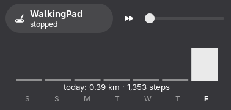

# walkingpad-controller

Nix-flaked control stack for KingSmith WalkingPad (Z1-series) treadmills:
a persistent BLE daemon, a socket CLI, and a GNOME Shell Quick Settings
extension.

Python sources live in `src/`, Nix modules and package definitions in
`nix/`, and the GNOME Shell extension in `gnome-extension/`. Run the
Python regression tests with `python -m unittest discover -s tests`
inside `nix develop`.



The extension as deployed on GNOME 50: the WalkingPad toggle with live
state and speed, the speed slider, and a seven-day steps histogram with
per-day details on hover.

## What is implemented

Everything ships from this flake; nothing is installed outside Nix.

**`walkingpad-daemon`** — holds the pad's single BLE link for the
lifetime of the service (connect/disconnect beeps happen once per
service start) and serves a JSON-lines control socket at
`/run/walkingpad/daemon.sock`. It speaks the wire protocol itself rather
than using the Python library: Z1-series firmware gates FTMS control
behind a KingSmith vendor unlock handshake that the library never
sends — without it, REQUEST_CONTROL is silently ignored and commands
answer "control not permitted" while the belt keeps running. The daemon
performs the unlock, keeps the link alive with silent property reads,
reconnects on failure, and force-drops stale BlueZ connections that
would otherwise block reconnection forever (the pad does not advertise
while any GATT connection exists, including a dead one bluetoothd never
tore down).

**Session history** — distance, duration and steps are accumulated as
per-frame counter deltas. A new session uses zero as its baseline, so
the first frame includes activity before the daemon connected. Ordinary
counter wraps are accumulated without wrapping the live display.
Stop notifications finalize sessions; pause notifications preserve them.
Finalized sessions are appended to
`/var/lib/walkingpad/history.jsonl`; an atomic 5-second snapshot of the
open session survives unclean shutdowns and is restored at daemon startup.
The next telemetry frame, including idle telemetry, resolves whether it
continued. History is served over the daemon's socket (`{"cmd": "history"}`)
because the state directory belongs to the service's dynamic user.

The pad provides no session identifier in telemetry. Across a gap, we
assume the session continued unless a modulo counter increment exceeds
3,600 seconds, 50,000 steps or 50,000 metres. Such a jump is treated as a
reset: record the old totals and seed a new session from the incoming
counters if the belt is moving. This deliberately simple heuristic suits
normal use with the computer present and short gaps such as a two-minute
reboot; it does not reconstruct every session missed while disconnected.
For example, 500 steps before a gap and 600 afterward are treated as 100
additional steps, even if the pad actually stopped and began a new session.
More than an hour of continued walking during a gap may be mistaken for
a reset, making the recorded old totals overlap the newly seeded totals.
Complete counter wraps before the first sample or during a long gap cannot
be reconstructed reliably. Live totals and history use the same accounting,
which continues even if history persistence is disabled.

Status parsing follows standard FTMS: `02 01` is stop, `02 02` is pause,
`01` is reset and `03` is safety stop. See the
[Bluetooth SIG test suite, page 48](https://files.bluetooth.com/wp-content/uploads/dlm_uploads/2024/10/FTMS.TS_.p6.pdf).
If firmware omits the stop/pause parameter, accounting stays open until
counter telemetry demonstrates a reset or a daemon stop command succeeds.
After a known stop, trailing telemetry is ignored until a start or reset
establishes the next session.

**`walkingpad-client`** — pure-stdlib CLI for the daemon socket:
`status`, `start --speed`, `speed`, `pause`, `stop`, `set-buzzer`,
`properties`, `watch`, and `history` (per-day distance, duration and
steps). Fish, bash and zsh completions are generated from the CLI's
real argparse parser at build time
([shtab](https://github.com/iterative/shtab)), so they can never drift
from the commands; shtab is a build-time dependency only.

**`walkingpad-cli` / `walkingpad-sandboxed`** — a small one-shot CLI
(scan / info / start / speed / stop) built on the
[walkingpad-controller](https://github.com/mcdax/walkingpad-controller)
Python library, the latter wrapped in a bubblewrap sandbox that exposes
exactly one host resource (the D-Bus system bus for BlueZ).

**GNOME Shell extension** — a Quick Settings entry: the WalkingPad
toggle (live state, `walking @ 3.0 km/h`, and a local 3–2–1 start
countdown followed by `starting…` while waiting for the belt), a speed
slider with an optimistic hold until the pad confirms, and a 7-day steps
histogram with exact per-day values on hover. Talks to the daemon over
the same control socket.

**`services.walkingpad`** — the NixOS module: the daemon as a systemd
service under a dynamic user with tight sandboxing (AF_UNIX only, no
devices, no network, read-only system), the client on PATH for every
user, and the session history in a persistent state directory.

## Usage

Add the flake to your inputs and import the NixOS module:

```nix
# flake.nix
{
  inputs.walkingpad.url =
    "git+ssh://git@github.com:ambiso/walkingpad-controller.git";

  outputs = { self, nixpkgs, walkingpad, ... }: {
    nixosConfigurations.machine = nixpkgs.lib.nixosSystem {
      modules = [
        ./configuration.nix
        walkingpad.nixosModules.default
      ];
    };
  };
}
```

Then enable the service:

```nix
# configuration.nix
services.walkingpad.enable = true;

# Optional but recommended: pin your pad's BLE address so discovery can
# never grab a neighbour's belt. Find it with `bluetoothctl scan on` and
# looking for a device named KS-HD-*, or with
# `walkingpad-sandboxed scan`. Omit the option to discover by the KS-
# name prefix instead.
services.walkingpad.deviceAddress = "AA:BB:CC:DD:EE:FF";

# Optional: install the GNOME Shell Quick Settings extension for every
# user. Each user enables it once with
# `gnome-extensions enable walkingpad@ambiso` (and re-logs in).
services.walkingpad.gnomeExtension = true;
```

With the service running, `walkingpad-client` is on PATH for every
user:

```
$ walkingpad-client status
$ walkingpad-client start --speed 3.0
$ walkingpad-client speed 4.5
$ walkingpad-client stop
$ walkingpad-client history
2026-10-08    1.50 km  0:20:00    1800 steps  (1 session)
2026-10-09    2.09 km  1:57:28    6387 steps  (2 sessions)
open session:   0.30 km  0:04:00    350 steps  (not yet counted)
```

The pad serves exactly one BLE connection: while the daemon runs the
KS Fit app cannot attach. `systemctl stop walkingpad` frees the belt
for the app again.

## Credits

- **[slandau3/z1-walkingpad-mcp](https://github.com/slandau3/z1-walkingpad-mcp)** —
  the macOS client with the fanciest interface for the same pad; its
  protocol write-up (MIT) is the basis for the daemon's frame formats
  and the vendor unlock handshake.
- **[mcdax/walkingpad-controller](https://github.com/mcdax/walkingpad-controller)** —
  the Python library (MIT) this repo packages; the one-shot CLI is
  built on it.
- **[anativ/R1-Walkingpad-Controller](https://github.com/anativ/R1-Walkingpad-Controller)** —
  an additional protocol reference.
- **duttke.de** — the Web Bluetooth implementation of the Z1 protocol.

## AI use disclosure

The daemon, client, GNOME Shell extension, Nix packaging and NixOS
module in this repository were developed with substantial AI
assistance (Mistral's Vibe CLI agent and models), from protocol
knowledge documented by the projects credited above. All of it was
reviewed and tested against real hardware (a KS-HD-Z1E, firmware
J41_V301.10.22) during development.
